# Improved Sparrow Algorithm Optimized for Maximal Correlation Kurtosis Deconvolution, Achieving Early Weak Fault Diagnosis, MATLAB Code Implementation

01 Introduction
Due to the minor impacts caused by early failures of some equipment, which are easily obscured by system noise, it is crucial to effectively reduce noise in the original fault signal and enhance the faint impact components within the signal. This is a key aspect of early fault diagnosis for such components.
The Maximum Correlation KDE (MCKD) method, through deconvolution operations, highlights continuous impulse pulses buried in noise, improving the correlation coefficient of the original signal. It is very suitable for extracting continuous transient impacts from faint fault signals. Numerous literature have proven that MCKD can be used for early subtle fault diagnosis.
02 Process Introduction
The approach in this article can be referred to this paper, which has been highly cited and downloaded: Zhang Jun, Zhang Jianqun, Zhong Min et al. Fault Diagnosis of Wind Turbine Bearings with Early Weak Faults Based on PSO-VMD-MCKD Method [J]. Vibration Testing and Diagnosis, 2020, 40(02): 287-296+418. DOI: 10.16450/j.cnki.issn.1004-6801.2020.02.011.
Process introduction:
① Simulate early fault signals and add strong Gaussian white noise to simulate the faint faults covered by environmental noise in actual working conditions;
② Find the optimal IMF component: Use VMD or EMD to decompose the fault simulation signal, calculate the envelope spectrum peak factor of each IMF component, and the IMF component with the largest envelope spectrum peak factor is the optimal IMF component;
③ Use the stork algorithm with fused cosine and Cauchy mutation to optimize three parameters of the maximum correlation KDE (MCKD), obtaining enhanced IMF components;
④ Conduct envelope spectrum analysis on the IMF components to obtain fault characteristic frequencies.
03 Results Analysis
① Simulate early weak fault signals
Signal principle formula:
Signal result diagram:
(1) Impact signal, which is the impact signal before adding Gaussian white noise.
(2)Fault simulation signal, which is a high-gaussian white noise followed by an impact signal. It can be seen that the periodic impact signal is completely overshadowed by the noise.
 (3)Envelope spectrum of fault simulation signal, it is difficult to find prominent frequencies from this figure and cannot distinguish the fault characteristics.
②Find the best IMF component
VMD is used to decompose the fault signal into several IMF components, then calculate the envelope spectrum peak factor of each IMF component, the IMF component with the maximum envelope spectrum peak factor is considered as the best IMF component;
Set the number of modal decomposition modes K = 10 according to experience. (If you want to optimize the parameters of VMD through optimization, you can also do so. You can refer to the previous article about optimizing VMD parameters, which will not be explained here)
The envelope spectrum peak factor graph of each IMF component is as follows:
It can be seen that the best IMF component is IMF7. Then the following operations are all based on this IMF7.
Perform envelope spectrum analysis on IMF7,
For more VMD related analysis, you can refer to this article:VMD Decomposition, MATLAB Code, Envelope Line, Envelope Spectrum, Center Frequency, Skewness Value, Energy Entropy, Sample Entropy, Fuzzy Entropy, Arrangement Entropy, Multi-Scale Arrangement Entropy, Xiu University dataset example
③Improved Sparrow Algorithm Optimization for MCKD Parameters
In the original literature, only the [L,T] two parameters of MCKD were optimized. The author here made improvements, optimizing the [L,T,M] three parameters to ensure finding the optimal MCKD parameters.
The fitness function still chooses the envelope spectrum peak factor. The improved Sparrow Algorithm optimization curve for MCKD is as follows.
Processing steps are as follows:
The best parameters obtained are [L,T,M] = [242,99,1];
The envelope spectrum after MCKD processing is as follows:
It can be seen that Compared with the IMF component envelope spectrum before optimization, Significantly enhanced. The fault characteristic frequency fi and its double frequency in the envelope spectrum after deconvolution. 3x The spectrum lines of 4 times frequency are all clear. Indicates that the feature frequency is accurately extracted.
04 Code
%% \nclear\nclc  \nclose all\nfobj=@mckdcost;       %Envelope Spectrum Peak Factor\n%% Selection of data\nload data.mat  % Note: Here replace your own data. The data should be in n rows * 1 column, and the number of columns must be 1.\ndata = best_imf;\n%% Set parameters\nlb = [100 85 1];    %mckd lower limit\nub = [1000 142 7];  %mckd Limit\ndim = 3;            % Optimize the number of variables\nMax_iter=20;       % Maximum number of iterations\nSearchAgents_no=20;       %Population size\nfs = 12800;   % Sampling frequency\n%% Call SCSSA function\n[fMin , bestX, Convergence_curve ] = SCSSA(SearchAgents_no,Max_iter,lb,ub,dim,fobj,data,fs);\n\n%% Plot the fitness function curve and output the optimal parameters.\nfigure\nplot(-Convergence_curve,'Color',[0.9 0.5 0.1],'Marker','>','LineStyle','--','linewidth',1);\n\ntitle('Objective space')\nxlabel('Iteration');\nylabel('Best score obtained so far');\nlegend('SCSSAOptimizationMCKD')\ndisplay(['The best solution obtained by SCSSA is : ', num2str(fix(bestX))]);  % Output the best location\ndisplay(['The best optimal value of the objective funciton found by SCSSA is : ', num2str(-fMin)]);  % Output the best fitness value\n\n%% Backtrack the optimal MCKD parameters to find the result.\n\nfilterSize = fix(bestX(1));\ntermIter = 30;\nT = fix(bestX(2));\nM = fix(bestX(3));\nplotMode = 0;\n%--------------- Run actual mckd code: Data to be mckd decomposed ---------------------------\n[y_final,~,~] = mckd(data,filterSize,termIter,T,M,plotMode);\nThe code directory is as follows.:   
During runtime, first run Simulate_impact_signal.m to generate a fault simulation signal, then run main.m.

## Images

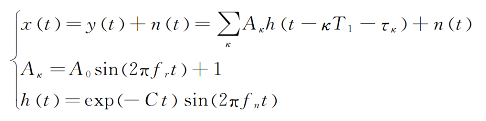
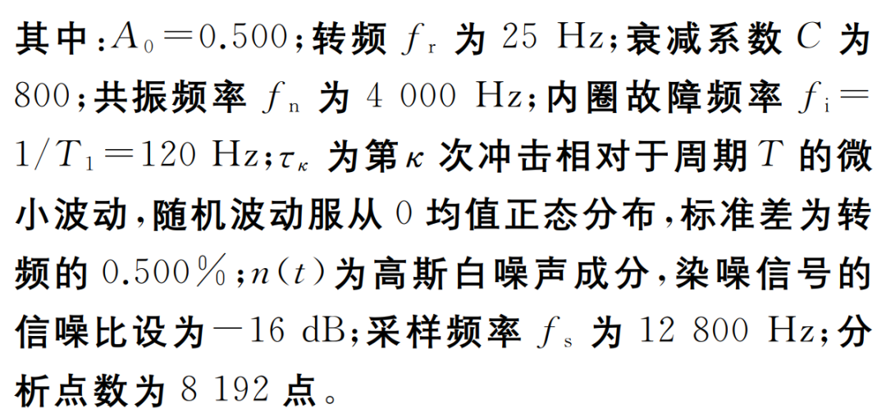
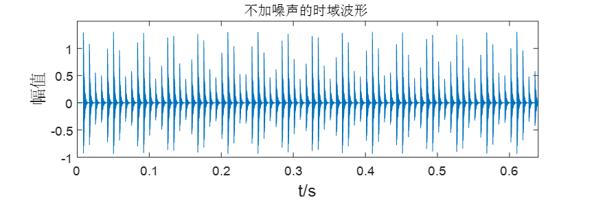
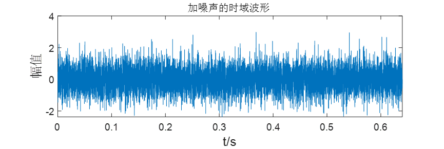
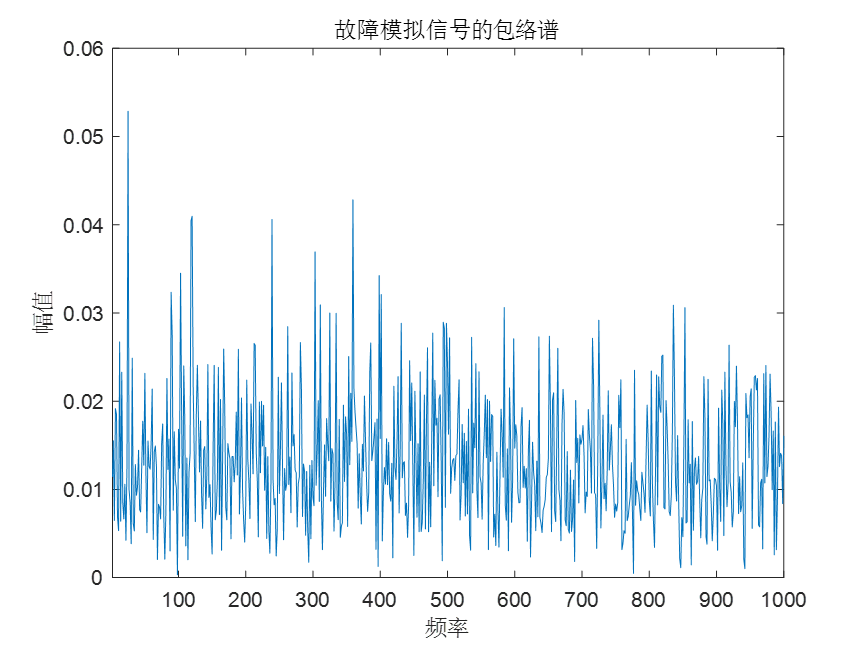
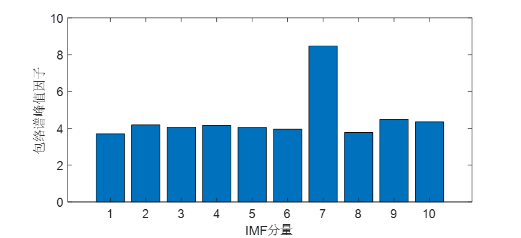
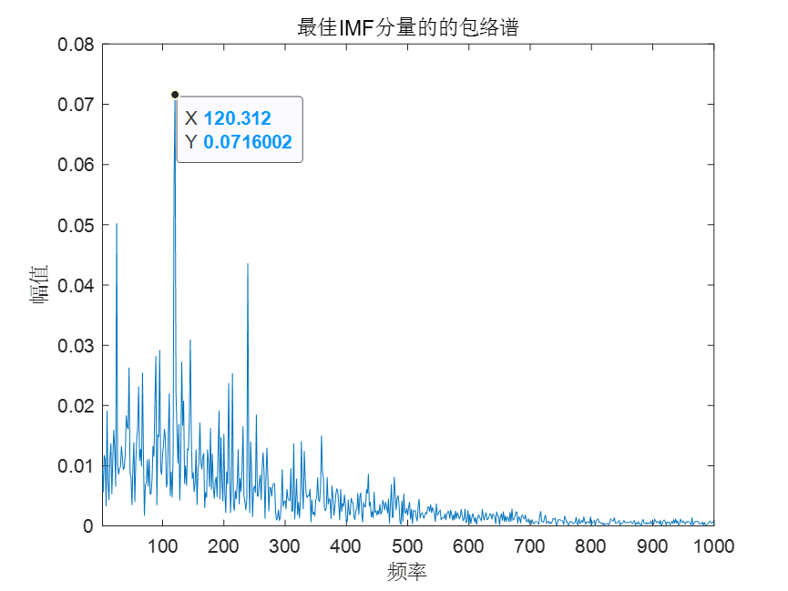
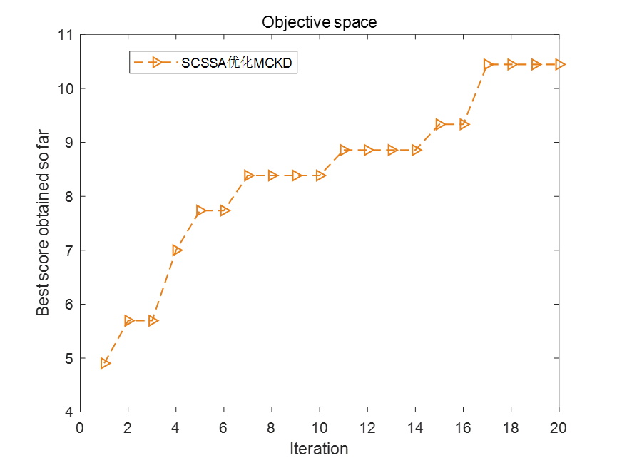
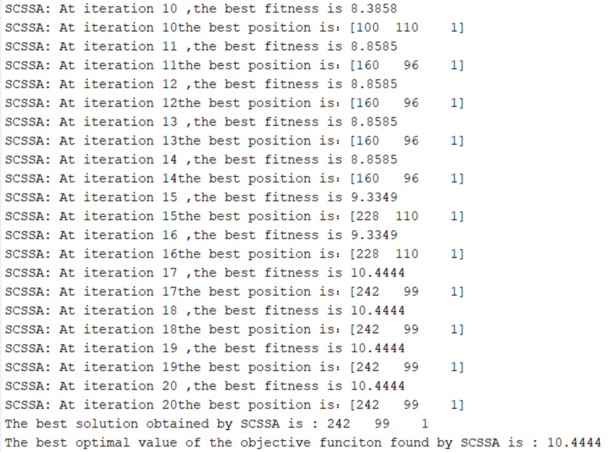
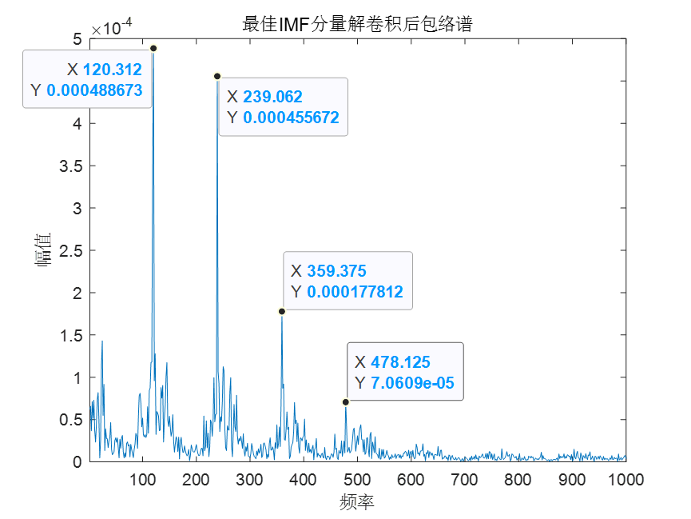
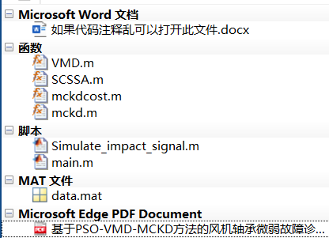

<!-- PAYMENT_BLOCK -->

## Get this dataset

- Payment link (Stripe): [Buy now](https://buy.stripe.com/3cs8yP7sY87d0vu9AB)
- Payment QR code: 

<!-- /PAYMENT_BLOCK -->
